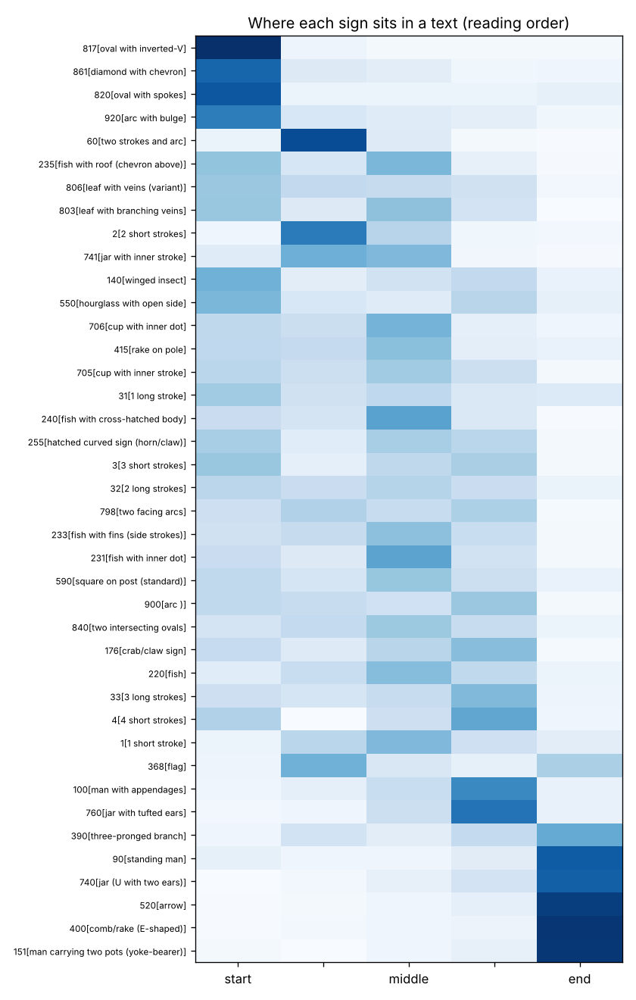
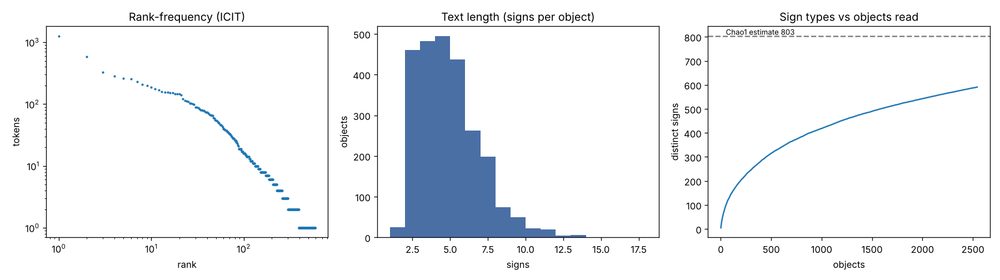
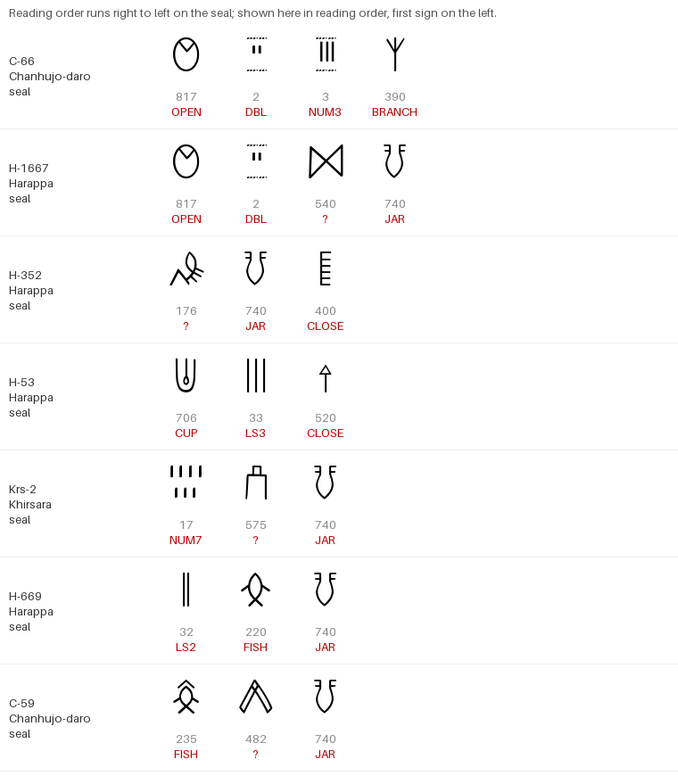

# The Indus Script: Evidence, Previous Research, and a New Attempt at Decoding

*Compiled October 2026. The literature review covers work up to this date. The analysis is original and fully reproducible (see [Reproducing the analysis](#11-reproducing-the-analysis)).*

---

## 0. Bottom line

1. **The Indus script has not been deciphered, and neither has this project.** No one can read it phonetically. Nobody knows which language it records. Every claimed decipherment in the last hundred years has failed independent checking or remains unverified. That includes the Dravidian, Sanskrit/Indo-Aryan, Sumerian and Munda readings, and the 2024 "cryptanalytic Sanskrit" claim. Two things block decipherment: there is no bilingual text, and the corpus is tiny and formulaic (about 4,000–5,000 objects, averaging 4–5 signs each).
2. **We can still decode a lot about how the script works.** Two independently transcribed corpora were analysed: ICIT/Yajnadevam (2,543 objects) and Mahadevan 1977 (3,573 lines). They support the following:
   - **The script is read right to left.** The text-final position is far more constrained than the initial one: 23 signs cover 80% of text endings, while 103 signs are needed to cover 80% of beginnings.
   - **It has about 400–800 signs.** That is the size of a **logo-syllabic** system, like Sumerian cuneiform, Maya or Luwian hieroglyphs. An alphabet or a pure syllabary would have far fewer signs.
   - **Texts follow a three-zone template:** **OPENING → CORE → CLOSING.** The order can be predicted on held-out texts from position alone (Kendall τ = 0.65 vs. 0.01 for chance).
   - **Specific sign functions can be identified.**
     - An *opening formula*: an oval or diamond sign followed by a "two short strokes" satellite.
     - *Numerals* made of short-stroke groups. These qualify the sign that follows them, so the order is number + counted thing.
     - A productive *fish class*.
     - A bound *closing element*, the "jar" sign, sometimes followed by a small set of *final signs* (comb, arrow, human figures).
   - **The text on a seal does not depend on the animal pictured on it.** Across 1,146 seals, sign–motif mutual information equals the shuffled baseline (0.223 vs. 0.220 bits), and 0 of 405 sign–motif tests survive correction for multiple testing. The animal and the text carry separate information.
   - **Seals and tablets are different genres.** 86% of seal texts are unique, which fits individual names or titles. 61–69% of tablet texts are repeated, which fits mass-produced tokens or amulets.
   - **The script is strongly standardised.** Between Mohenjo-daro and Harappa, about 600 km apart, only 3 of 73 common signs differ in frequency.
3. **On the language, the best guess is not settled.** Taken together, the external evidence (genetics, loanwords, chronology, toponymy) favours a **non-Indo-Aryan language**. Proto-Dravidian, or a language related to it, is the leading candidate. An extinct language family ("Language X") is a strong alternative. Nothing in the script itself can yet distinguish between these.

The rest of this report gives the evidence for each statement.

---

## 1. What the Indus script is

| Fact | Detail |
|---|---|
| Civilisation | Indus or Harappan Civilisation, Pakistan and NW India. Mature/Urban phase c. 2600–1900 BCE. Major cities: Mohenjo-daro, Harappa, Dholavira, Rakhigarhi, Ganweriwala, Lothal, Kalibangan. |
| Earliest signs | Graffiti on pottery from the **Ravi phase at Harappa, c. 3300–2800 BCE**. Mostly single signs, so these are proto-writing. The full script appears c. 2600 BCE together with square stamp seals. |
| End | The script disappears from inscribed objects after c. 1900 BCE, during urban decline. There are no later descendants. Claimed links to Brahmi (3rd c. BCE) are unproven. |
| Corpus size | About 4,000–5,000 inscribed objects in total, depending on counting rules. Mahadevan (1977) listed **3,573 lines on 2,906 objects**. Parpola's *Corpus of Indus Seals and Inscriptions* (CISI, 1987–2010s) gives photographs. The *Interactive Corpus of Indus Texts* (ICIT; Wells & Fuls) is the largest digital catalogue. |
| Objects | Stamp seals (square, usually with an animal; the "unicorn" is the most common), sealings, incised and bas-relief miniature tablets, pottery graffiti, copper tablets, bangles, tools. There is also the 10-sign **Dholavira "signboard"**, with letters about 37 cm tall. |
| Text length | Very short. In the corpus used here the mean is 4.4 signs and the median is 4. 75% of texts have 5 signs or fewer. The longest single-surface text is 17 signs; the longest text across several faces is about 26. |
| Sign count | 417 (Mahadevan 1977), about 400 (Parpola 1994), about 700 (Wells / ICIT). The number depends on how variants are split or merged. |
| Direction | Right to left in the great majority of texts. Shown by spacing and cramping at the left edge, overlapping strokes, and multi-line layout (B. B. Lal 1966; Mahadevan 1977). This analysis independently confirms it (§7.1). |
| Bilinguals | **None.** Indus seals and weights were found in Mesopotamia (Ur, Kish, Susa) and the Gulf (Bahrain, Failaka), and "Meluhha" appears in cuneiform texts. No inscription gives the same text in Indus script and a known script. |

---

## 2. A century of decipherment attempts

| Year(s) | Researcher(s) | Proposed language / approach | Outcome |
|---|---|---|---|
| 1920s–30s | Marshall, Langdon, Gadd, Smith, Hunter (1934) | Compared with Sumerian/Proto-Elamite; Hunter compared it with Brahmi | First sign lists. No decipherment. Hunter's structural observations (affixes, word-dividers) still hold. |
| 1930s | Hrozný | Hittite / Indo-European | Rejected |
| 1930s–50s | Heras | Proto-Dravidian (Tamil-like) readings | Started the Dravidian hypothesis. Readings were not accepted. |
| 1964–79 | Knorozov and the Soviet team | Proto-Dravidian; structural-positional analysis | Good structural work. Phonetic readings unverified. |
| 1969– | Parpola, Koskenniemi and the Finnish team | Proto-Dravidian via rebus (e.g. *mīn* "fish" = *mīn* "star") | Most detailed Dravidian framework (*Deciphering the Indus Script*, 1994; *A Dravidian Solution*, 2010). Internally coherent but unverifiable. Readings like *aṟu-mīn* (6 + fish = Pleiades) cannot be tested. |
| 1977–2014 | Iravatham Mahadevan | Concordance; Dravidian, with the jar sign as a grammatical/title morpheme | Created the standard concordance. The Dravidian readings, e.g. via Rigvedic loan-translations (2014), remain unproven. |
| 1982 | S. R. Rao | Indo-Aryan, partly alphabetic, Semitic-like values | Rejected. A sign count of about 400 is incompatible with an alphabet. |
| 1992 | Fairservis | Dravidian, from administrative context | Unverified |
| 2000 | Jha & Rajaram | Vedic Sanskrit; claimed a "horse seal" | **Exposed as manipulated.** A broken bull seal was digitally altered (Witzel & Farmer, *Frontline* 2000). |
| 2004 | Farmer, Sproat & Witzel | **Not writing at all**: a non-linguistic symbol system | Influential and heavily disputed (§4) |
| 2009–2010 | Rao, Yadav, Vahia, Mahadevan, Adhikari et al. | Information theory: conditional entropy and Markov models | Argued the sign sequences are "language-like". Sproat (2010, 2014) and others contested this. Methodologically important. |
| 2015– | Wells & Fuls | ICIT database; structure, numerals, metrology | Most comprehensive digital corpus. Wells (2015) gives a structural analysis. |
| 2019–2023 | Bahata Ansumali Mukhopadhyay | Mostly logographic; Dravidian "tooth" word (*pal*); seals for taxation, trade and access control, not personal names | Published in *Humanities & Social Sciences Communications*. Plausible functional arguments; contested. |
| 2024 | Yajnadevam | "Cryptanalytic" reading as a Sanskrit proto-abugida | Self-published. Relies on a hand-augmented dictionary and flexible spelling rules. A 2026 preprint showed the same kind of procedure reaches high "dictionary coverage" for English, Sanskrit **and** Tamil on a synthetic emblem system that has no phonetic values at all (arXiv:2608.02999). **Not accepted.** |
| 2025 | Tamil Nadu govt.; Rajan & Sivananthan | US$1 million prize; comparison of Indus signs with about 15,000 South Indian graffiti sherds | Visual similarity is reported, but it does not establish language. Prize unclaimed. |
| 2025–26 | Various computational / ML preprints | Synthetic-baseline scorecards (arXiv:2604.17828), Indus–Tibetan-Yi visual similarity (arXiv:2503.21074), transformer sign prediction | Useful for structure. None yields phonetic values. |

**Pattern:** every phonetic decipherment so far shares the same flaws. Each chooses a language first, assigns values through rebus or acrophony with many degrees of freedom, and then "reads" a handful of very short texts. With roughly 400 unknown sign values and texts 4–5 signs long, almost any language can be made to fit. This is the core reason none has been accepted.

---

## 3. External evidence about the language

| Line of evidence | What it shows | Weight |
|---|---|---|
| **Chronology of Indo-Aryan** | Linguistics (the Rigveda, Mitanni Indo-Aryan c. 1400 BCE) and ancient DNA (steppe ancestry entering South Asia c. 2000–1500 BCE; Narasimhan et al. 2019, *Science*) place Indo-Aryan arrival **after** the Mature Harappan. | Strongly against Sanskrit/Indo-Aryan as the script's main language |
| **Rakhigarhi genome** (Shinde et al. 2019, *Cell*) | The Harappan-period individual has no steppe ancestry. The ancestry is a mix of local hunter-gatherer and Iranian-related lineages, the "Indus Periphery Cline", which is also the main ancestral source of present-day South Indians. | Compatible with a Dravidian-related language, but genes are not languages |
| **Brahui** | A Dravidian language still spoken in Baluchistan, inside the Indus zone. It may be a relic or a later migrant. | Suggestive only |
| **Rigvedic substrate** (Kuiper; Masica's "Language X"; Witzel's "Para-Munda") | The Rigveda contains about 300+ non-Indo-European words, including agricultural and craft terms. Some are Dravidian, some Munda-like, and many come from **unknown** sources. Retroflex consonants spread into Indo-Aryan from a substrate. | Shows the NW region was multilingual. Supports Dravidian, Para-Munda, or a lost language |
| **Mesopotamian "Meluhha"** | Akkadian texts name Meluhha (very likely the Indus) and its goods (carnelian, ivory, wood). A cylinder seal belongs to **Shu-ilishu, "interpreter of the Meluhhan language"** (Akkad period). Few Meluhhan personal names survive. | Confirms a distinct language that needed interpreters, but its identity is unknown |
| **Loanword arguments** (e.g. Mukhopadhyay 2021, Dravidian *pal* "tooth" → elephant-tusk/ivory words in Near Eastern languages) | Proposes Dravidian lexical traces in Bronze Age trade vocabulary | Interesting and debated |
| **South Indian graffiti** (Tamil Nadu 2025) | Similar signs on Iron Age sherds | Weak. Simple graffiti marks recur everywhere. |

**Assessment:** The combined external evidence favours **a non-Indo-Aryan language: Proto-Dravidian or a relative of it, or a now-extinct family**. The civilisation covered about a million km², so it may have used more than one language. Even so, the script's standardisation (§7.11) suggests one administrative written standard.

---

## 4. Is it writing at all?

**The non-linguistic thesis** (Farmer, Sproat & Witzel 2004) rests on several observations:
- texts are extremely short;
- many signs are hapax (occur once);
- there is little sign repetition within texts;
- no long texts survive, and there is no evidence of manuscripts.

From this they argued the signs were emblems, like heraldry or religious symbols.

**Counter-arguments** (Parpola 2005; Vidale 2007; Rao et al. 2009/2010; Mahadevan; Wells):
- The signs show strong **sequential syntax**: fixed beginnings and endings, recurrent multi-sign formulae, and a predictable order.
- A **sign inventory of about 400** is typical of logo-syllabic writing.
- **Ligatures and diacritic-like modifications** follow consistent rules.
- Seal texts look like the brief **name + title formulae** of contemporary Mesopotamian seals.
- Short texts are normal for the surviving genres (seals and tags). Perishable media such as palm leaf, cloth or wood would not survive.

**The methodological lesson (2010–2026):** entropy and Zipf statistics detect *structure*, not *language*. Sproat (2010, 2014) and the 2026 SIGIL experiment (arXiv:2608.02999) show that structured non-linguistic systems can reproduce the "language-like" fingerprints. Statistics can rule out pure randomness or rigidity, but they cannot prove speech is encoded.

**This report's position:** the evidence points to a writing system that was at least partly linguistic. The functional classes found here (numerals that bind to the counted item, bound terminal morphemes, and an opener that can be replaced by others in the same slot) are what one expects of logo-syllabic administrative writing. Calling it "language-like" is still an inference, not a proof.

---

## 5. Data used in this project

| Corpus | Source | Size | Use |
|---|---|---|---|
| **ICIT (Yajnadevam digitisation)** | [`yajnadevam/indus-website`](https://github.com/yajnadevam/indus-website), GPL-3.0. This is the SQL dump behind the site. Only the raw transcriptions are used here; that author's Sanskrit readings are **not** used. | 2,543 complete inscribed objects, 11,135 sign tokens, 591 sign types, 52 sites. Also object type, material, motif, CISI number and a sign font. | Primary corpus |
| **Mahadevan 1977 (M77 / IDF-80)** | CSV export distributed in [`joyboseroy/indus_decipher`](https://github.com/joyboseroy/indus_decipher) | 3,573 text lines, 417 signs (2,861 lines with no doubtful sign) | Independent replication. Different transcriber and sign list. |

Reading order had to be established for the ICIT data. In the database's stored order, the jar sign comes first in 868 of 872 texts that begin or end with it, whatever the "direction" flag says. So the stored order is the reverse of reading order, and every ICIT text was reversed. The M77 export is already in reading order: jar sign 342 is final.

Sign names such as "jar" and "fish" are descriptive labels given here from the glyph shapes, which were rendered from the ICIT font: see [`results/figures/signs_by_frequency_001.png`](../results/figures/signs_by_frequency_001.png). They are **not** readings. ICIT sign numbers are used throughout. Where an M77 number is known to correspond, it is noted, e.g. jar = ICIT 740 = M342.

---

## 6. Methods (summary)

Everything is in [`analysis/run_analysis.py`](../analysis/run_analysis.py) and [`analysis/functional_reading.py`](../analysis/functional_reading.py). Raw output is in [`results/analysis_log.md`](../results/analysis_log.md).

- **Sequence statistics** use the 1,828 *unique* single-line texts, so that duplicated tablets do not inflate counts.
- **Genre, motif and site analyses** use all objects.
- Positional profiles; positional entropy; Chao1 estimate of the sign inventory; Zipf fit.
- Conditional entropy against within-text-shuffled and unigram-random controls; held-out n-gram cross-entropy (5-fold).
- Recurrent n-grams with PMI; unsupervised segmentation (a unigram "word" model with hard-EM Viterbi).
- Distributional sign classes: PPMI left/right context vectors, cosine similarity, average-linkage clustering. Substitution frames (X _ Y minimal pairs).
- Kober-style alternations: shared stems with varying ends, and vice versa.
- Attachment direction: PMI of each sign with its following vs. its preceding neighbour.
- Sign–motif association: Fisher exact tests with Benjamini–Hochberg FDR, plus mutual information against a 200-permutation null.
- Regional variation: Mohenjo-daro vs. Harappa seals, Fisher + FDR.
- Positional-template test: each sign's mean relative position is learned on 80% of texts. On the held-out 20%, the predicted order is compared with the real order using Kendall τ.

---

## 7. Results

### 7.1 Direction and the shape of a text

| | ICIT | M77 |
|---|---|---|
| Entropy of first sign | 7.02 bits | 6.49 bits |
| Entropy of last sign | **4.59 bits** | **4.39 bits** |
| Signs covering 80% of beginnings | 103 | 62 |
| Signs covering 80% of endings | **23** | **15** |
| Share of texts ending in the jar sign | 36% | 31% |

Both corpora agree: **texts end in a small, closed set of signs and begin with an open set.** This matches the direction established from physical evidence. It also matches what one expects if endings carry grammatical or formulaic material (suffixes, titles, classifiers).



### 7.2 Sign inventory → script type

- 591 sign types in 11,135 tokens. 199 of them (34%) occur only once.
- The Chao1 richness estimate is **about 800 types** at ICIT's fine granularity. M77, which merges more variants, has 417.
- The type-count curve (below) has not levelled off, so new signs would still appear with more finds.
- The top 10 signs make up 34% of tokens. Zipf slope ≈ −1.17.



**Interpretation:** about 400 signs (merged) to about 800 (split) is far too many for an alphabet (20–40) or a syllabary (40–100). It is typical of **logo-syllabic** scripts: Sumerian, Hittite and Luwian hieroglyphs, Maya, early Chinese. In such scripts most signs are word-signs (logograms), with a smaller set used for sounds or grammatical endings. This fits the large number of rare signs alongside a small, very frequent core.

### 7.3 Sequential structure is real

| Vocabulary (top-N signs) | H(next \| current), real | within-text shuffled | random |
|---|---|---|---|
| 20 | 2.41 | 2.94 | 2.99 |
| 80 | 3.48 | 4.44 | 4.54 |
| 320 | 3.72 | 4.77 | 4.88 |

On held-out texts, a bigram model predicts the next sign at **5.43 bits/sign**. The same model on order-shuffled texts gets **6.58**. **Sign order therefore carries about 1.1 bits per sign of information.** Higher-order models did not improve further at this corpus size (sparsity).

### 7.4 Recurrent formulae (in reading order)

| Group | Count | Note |
|---|---|---|
| diamond-with-chevron (861) + two short strokes (2) | 115 | opening formula |
| oval-with-inverted-V (817) + two short strokes | 93 | opening formula |
| jar (740) + comb (400) | 84 | closing formula |
| oval-with-spokes (820) + two short strokes | 69 | opening formula |
| jar-with-tufted-ears (760) + jar | 65 | pre-closing |
| cup-with-stroke (705) + three long strokes (33) [+ arrow (520)] | 54 [21] | fixed 3-sign formula |
| square-on-post (590) + three-pronged branch (390) + jar | 30 | fixed formula, found at several sites |
| arc-with-bulge (920) + two-strokes-and-arc (60) + jar-with-stroke (741) | 28 | PMI 10.0: almost always together |
| hatched horn (255) + hook (435) + X-in-brackets (690) + jar | 18 | 4-sign fixed unit, PMI 17 |
| 7 strokes (17) + pot-on-stand (575) / trident-on-stand (585) + jar | 12 / 11 | numeral + object + jar |

The mirror pair in M77 is the same. Its most common bigram is **267 → 99**, oval + two short strokes (249×), and its second is **342 → 176**, jar + comb (160×).

Unsupervised segmentation finds 484 recurring multi-sign units. These cover **62%** of all tokens, so most texts are built from a limited stock of reusable blocks ("words" or "phrases").

### 7.5 Three functional zones (the template)

Held-out test: each sign's average position was learned on 80% of texts. Ordering the signs of unseen texts by those averages gives Kendall **τ = 0.645** against the real order, versus 0.006 for random order. For texts with 3+ known signs, 34% are ordered **exactly** right. The template is:

```
 OPENING                          CORE                                   CLOSING
 ┌──────────────────────────┐  ┌────────────────────────────────────┐  ┌───────────────────────────┐
 │ oval/diamond sign        │  │ numeral → counted sign             │  │ (pre-jar sign) → JAR       │
 │ (817, 861, 820, 692, 920)│→ │ fish-class (+modifiers)            │→ │   [→ comb 400 | arrow 520 │
 │   + 'two short strokes'  │  │ branch-class, standards, vessels   │  │      | man 90 | yoke-     │
 └──────────────────────────┘  │ fixed multi-sign units             │  │      bearer 151/154]      │
                               └────────────────────────────────────┘  └───────────────────────────┘
   optional, ~25% of texts       obligatory, most variable               jar in ~50% of seals
```



### 7.6 The jar sign (ICIT 740 = M342): a bound closing element

- It is the most frequent sign, at **11.4% of all tokens**, and **73% of its occurrences are text-final**.
- **It almost never stands alone.** Only 2 of 2,543 objects have the jar as their whole text.
- What precedes it is an **open class**: **142 different signs**, with entropy 6.05 bits.
- What follows it is a **closed class**: comb, man, arrow, yoke-bearer.
- In Kober-style alternations, the final jar is replaced by the yoke-bearer figure (151) after identical stems (4 stems).
- It appears on about 50% of seals and also on tablets and sealings. It is rarer on pottery graffiti (31%).

**Reading:** behaviourally the jar is a **bound morpheme or determinative attached to the end of a phrase**. It is open on its left and almost never free. That is how case suffixes, honorific or title suffixes, or classifiers behave. Mahadevan and Parpola both treated it as grammatical or title-like. The data support that *functional* claim, but nothing can confirm a phonetic value (e.g. Dravidian *-an*).

### 7.7 Numerals: stroke groups qualify what follows

| Stroke sign | Main next signs | Attachment (PMI next − PMI prev) |
|---|---|---|
| 7 strokes (4 over 3) | pot-on-stand, trident-on-stand | **+2.6** (binds right) |
| 3 short strokes | fish, branch, arc, winged insect | **+1.4** |
| 4 short strokes | three-pronged branch (17 of 52), branch variants | **+1.0** |
| 5 short strokes | arc, branch, flag | **+1.0** |
| 6 strokes (3 over 3) | fish, branch | binds right |
| **2 short strokes** | — | **−1.2 (binds LEFT, to the opener)** |
| 3 long strokes | always after the cup sign, then arrow | **−1.8** (part of a fixed unit) |

- **Short-stroke groups of 3–12 behave like numerals followed by the thing counted** (Num → N order). They bind to the following sign, and each prefers a specific small set of following signs. For example, "4 + branch" and "7 + pot-on-stand" are counted items or numbered titles.
- **"Two short strokes" is not a numeral in most uses.** In 285 of 481 cases it is in second position, directly after the opener (58% of its occurrences follow 817/861/820). It is a satellite of the opening sign, perhaps a marker such as a dual, plural or determinative.
- **Long strokes are a separate system.** For example, "3 long strokes" occurs inside the fixed unit cup + ||| + arrow.

Num–N order occurs in Dravidian, Indo-Aryan, Munda and Elamite. Sumerian prefers N–Num in speech, though its accounting texts write the number first. So this is **not** diagnostic of a language family, and record-keeping conventions could produce it anyway.

### 7.8 The fish class

The fish (220) and its modified forms (roof 235, fins 233, hatching 240, dot 231, strokes 226/236) are the **most interchangeable set of signs in the corpus**. Each variant's context similarity to the plain fish is in the 95th–99.5th percentile of all sign pairs. The variants are also the top substitution pairs (e.g. 235 ↔ 240 share 27 frames). Leaf signs (803/806) and the "two facing arcs" sign (798) occupy the same slot.

Fish signs combine with numerals: 3 + fish (15 unique texts), 6 + fish (11 objects), 2 + fish variants (100+ unique texts). *Seven* + fish occurs once in reading order.

**Reading:** the fish signs form **one productive class** in which a base element is modified by diacritic-like additions. The modified forms are not free variants: they share contexts but are not identical. The class looks like a family of related names or titles. This *structure* is what Parpola's "*mīn* = star/deity" compound theory requires, and *aṟu-mīn* "6 + fish = Pleiades" is attested 11 times. The data cannot test the phonetic part.

### 7.9 Opening signs and what varies

- Texts that share everything after the first sign are **three times as common** (108 "tails") as texts that share everything before the last sign (37 "stems").
- The most frequent alternation is between the three openers 817 ↔ 861 ↔ 820 (24 shared tails).
- So the same core-plus-closing sequence appears with **different opening signs**.

This behaves like a set of **prefixed category or office markers**, attached to otherwise identical name/title formulae. It is the opposite of the "same stem, different case ending" pattern Kober found in Linear B. It suggests the variable grammatical slot is at the **beginning**, the closing is formulaic, and the opening classifies.

### 7.10 Seals vs tablets; independence from iconography

| Object type | Objects | Texts that recur on another object |
|---|---|---|
| Seals | 1,466 | **13.6%** |
| Bas-relief tablets | 456 | **61%** |
| Incised tablets | 292 | **69%** |
| Sealings | 64 | 58% |

- **Seal texts are mostly unique.** That is what individual identifiers (person, office, institution) would look like.
- **Tablets are mass-produced** with repeated texts. Examples: "3 short strokes + winged insect" appears on 22 incised tablets at Harappa, and identical formulae recur across sites. These fit tokens, receipts or amulets.
- **30 texts of 3 or more signs occur at more than one site.** For example, 590-390-740 appears at Allahdino and Chanhujo-daro, and 817-2-4-390 at Dholavira, Harappa and Mohenjo-daro. These look like titles or institution names rather than personal names.

**Iconography (1,146 seals with an identified animal):**
- Mutual information between motif and signs is **0.223 bits**. Shuffling the animals among seals gives a mean of 0.220 bits (maximum 0.244 over 200 shuffles). The excess is **0.003 bits, which is essentially zero.**
- **0 of 405** sign × motif Fisher tests survive FDR. Text length and jar frequency are similar across unicorn, gaur, zebu, elephant and rhinoceros seals.
- **So the text does not describe or depend on the animal.** The animal is a separate emblem: a clan, guild, office or deity symbol. The text carries other information (a name, title or commodity/authority), as Mesopotamian seals combine a figurative scene with an independent owner's name. Mukhopadhyay (2023) reached a related conclusion by other means.

### 7.11 One script, standardised

Mohenjo-daro (934 seals) and Harappa (254 seals) are about 600 km apart. Among 73 signs tested, only **3** differ significantly in frequency (q < 0.05). All three are drawing variants of commoner signs (yoke-bearer variant 154, branch 405, leaf 806) that Harappa prefers. They differ in drawing habit, not vocabulary. Spelling and sign use were **centrally standardised** across the civilisation.

### 7.12 Replication

Every structural result checked against M77 holds:
- the closed final set and open initial set;
- jar-final as the dominant ending;
- the oval + two-strokes opener;
- the jar + comb closer.

The two corpora have different transcribers and different sign lists, so the findings are not artefacts of one catalogue.

---

## 8. The decoding attempt: a functional transliteration

Phonetic decipherment is impossible with current evidence (§10). What *can* be done is to state what each frequent sign **does**. Every text in the corpus has been transliterated into functional roles in [`results/tables/functional_readings.csv`](../results/tables/functional_readings.csv). These roles cover 59% of all tokens. The rest are mostly rare signs, presumably logograms for specific words.

### 8.1 Functional sign glossary

| Role | Signs (ICIT) | Behaviour | Proposed function | Confidence |
|---|---|---|---|---|
| **OPEN** | 817 oval-with-inverted-V; 861 diamond-with-chevron; 820 oval-with-spokes; 692 X; 920 arc-with-bulge | 62–90% text-initial; bind rightwards; interchange with one another | Category / office / institution classifier that opens a seal legend | High (position); medium (function) |
| **DBL** | 2 "two short strokes" | 58% directly after OPEN; rarely initial or final | Satellite marker of the opener (number, dual/plural, or determinative) | High (position); low (meaning) |
| **NUMn** | short-stroke groups 1–12 (1–7, 13–19, 55, 56) | bind to the following sign; specific preferred partners | Cardinal numerals, Num→N order | Medium-high |
| **LSn** | long strokes 31–35 | form fixed units (e.g. cup + ||| + arrow); different distribution from short strokes | A separate system: perhaps a different counting series, or logograms | Medium |
| **FISH** | 220 and modified forms 222–243; FISH~ 803, 806, 798 | most interchangeable class; takes numerals; core zone | A family of names/titles built on one base element | Medium |
| **BRANCH** | 390, 405, 407, 413, 388 | follows numerals 3–5; precedes JAR; interchangeable | A countable noun class (plant/commodity?) or title element | Medium |
| **JAR** | 740 | 11% of tokens; 73% final; never free; open left context | Bound phrase-final morpheme: case/title suffix or classifier | High (bound, final); medium (grammatical) |
| **CLOSE** | 400 comb; 520 arrow; 527 half-ladder; 90 man; 151/154 yoke-bearer; 156 winged insect | 75–88% final; often directly after JAR; 151 can replace JAR | Final title/role words or a second suffix layer | Medium-high (position) |
| **CUP** | 705, 706 | almost always followed by 3 long strokes | First element of a fixed 3-sign formula | High (formula) |

### 8.2 Example functional readings

Shown in reading order; ICIT numbers in brackets.

| Object | Signs | Functional reading | Paraphrase of the *structure* |
|---|---|---|---|
| C-66 (Chanhujo-daro, seal) | 817-2-3-390 | OPEN DBL NUM3 BRANCH | [class-marker] · 3 × [branch-item] |
| H-1667 (Harappa, seal) | 817-2-540-740 | OPEN DBL x540 JAR | [class-marker] · [word 540] + [suffix] |
| H-352 (Harappa, seal) | 176-740-400 | x176 JAR CLOSE | [word 176] + [suffix] + [final title] |
| H-53 (Harappa, seal) | 706-33-520 | CUP LS3 CLOSE | fixed formula "cup-3-arrow" |
| Krs-2 (Khirsara, seal) | 17-575-740 | NUM7 x575 JAR | 7 × [pot-on-stand] + [suffix] |
| H-669 (Harappa, seal) | 32-220-740 | LS2 FISH JAR | [two-long-strokes] [fish] + [suffix] |
| Harappa incised tablets (22×) | 3-156 | NUM3 CLOSE | "3 × winged-insect": mass-produced token |

Read as Mesopotamian seal legends are, a typical seal text would mean something like:

> **[category/office]** · (**number ×**) **[named thing or person]** + **[suffix "of / the one of"]** (+ **[title]**)

That is, an owner's or office's identifier. This is consistent with seals having been used to mark goods and authorise access. The animal motif identifies a group, and the text identifies the bearer within it.

---

## 9. Testing proposed decipherments against the data

| Claim | Test here | Result |
|---|---|---|
| The signs are random emblems with no syntax | Order carries about 1.1 bits/sign; positional template τ = 0.65 on held-out texts | **Rejected.** Strong syntax. (This does not by itself prove language.) |
| Alphabetic or syllabic script (e.g. S. R. Rao) | Inventory 417–800 signs; Chao1 about 800 | **Rejected** |
| Sanskrit proto-abugida (Yajnadevam 2024) | Requires about 600 signs to carry short phonetic values. Its "unicity distance" argument does not hold when the dictionary and spelling rules are adjusted by hand. Equivalent procedures "read" synthetic non-language (arXiv:2608.02999). It also conflicts with the Indo-Aryan chronology (§3). | **Not supported** |
| Text describes the animal on the seal | MI excess 0.003 bits; 0/405 associations | **Rejected** |
| Seal texts are personal names | 86% of seal texts unique (supports); but 30 multi-sign texts recur at several sites, and opener prefixes vary (suggests titles/offices too) | **Partly supported:** names plus titles or institutions |
| Jar = grammatical suffix (Mahadevan) / genitive-like morpheme | Bound, final, open left context, almost never free | **Supported functionally**; phonetics untestable |
| Fish = Dravidian *mīn* "star"; 6 + fish = *aṟu-mīn* (Parpola) | Fish class is real and productive; 6 + fish is attested 11× | **Consistent but unverifiable.** The same structure fits other languages. |
| Mostly logographic (Mukhopadhyay 2019) | Large inventory, many rare signs, formulaic units | **Consistent** |
| Inscriptions do not encode any proper names (Mukhopadhyay 2023) | Cross-site repeats and openers that substitute for one another support titles/offices, but 86% seal uniqueness leaves room for names | **Open** |

---

## 10. Why phonetic decipherment is not currently possible, and what would change that

1. **No bilingual.** Every successful decipherment of a lost script has used one of three things:
   - a bilingual text (Egyptian: the Rosetta Stone; Old Persian/Akkadian: Behistun);
   - a known language plus a corpus large enough to test internally (Linear B: Ventris plus Greek, with thousands of tablets);
   - surviving descendant traditions (Maya: Landa's "alphabet" and living Mayan languages).
   The Indus has none of the three.
2. **The language is unknown.** Even the language family is uncertain. Proto-Dravidian is reconstructed only for c. 1500–1000 BCE and later, and may not match the Harappan language closely.
3. **The corpus is too small and too formulaic.** About 11,000–15,000 tokens spread over about 400–800 signs, with most texts 3–5 signs long. Most signs occur fewer than 10 times. With that many free parameters, a flexible reading can be "confirmed" in any language. That is why the competing Dravidian, Sanskrit and other readings can all claim internal consistency.
4. **There is no external check.** A decipherment must yield readings that can be checked independently. Candidates would be Meluhhan names in cuneiform, place names, or new long texts that "read" correctly without adjustment. No proposal has done this.

**What could crack it:**
- (a) A **bilingual**: an Indus seal or tablet with a cuneiform caption, most likely from Mesopotamia, Susa or the Gulf.
- (b) **Longer texts**, e.g. a cache of perishable-medium records or more Dholavira-type monumental inscriptions.
- (c) **Meluhhan names in cuneiform** matched to recurring Indus seal formulae, the way Ventris used Cretan place names.
- (d) Continued work on **numerals and metrology**: matching numeral + commodity formulae against the standardised Indus weight system. This is the most promising *internal* route to fixing the meanings (not sounds) of some signs.

---

## 11. Reproducing the analysis

```bash
./data/fetch_sources.sh                 # clones the two source corpora (pinned commits) into data/raw/
python3 analysis/build_corpus.py        # -> data/derived/*.csv
python3 analysis/render_signs.py 200    # sign contact sheets -> results/figures/
cd analysis && python3 run_analysis.py  # all statistics -> results/summary.json, results/tables/, results/analysis_log.md
python3 functional_reading.py           # functional transliteration -> results/tables/functional_readings.csv
```

Requires Python 3.10+ with numpy, scipy, matplotlib and pillow. Random seeds are fixed. Third-party corpora are downloaded rather than committed, so each keeps its own licence.

**Limitations:**
- The ICIT digitisation contains only complete texts.
- Sign identities depend on transcription choices (allograph splitting).
- The motif analysis is dominated by unicorn seals (939 of 1,146), so it has little power for rare animals.
- Statistical "language-likeness" is not proof of language (§4).
- The functional roles are inferences from distribution.

---

## 12. References (selected)

- Farmer, S., Sproat, R., Witzel, M. (2004). The collapse of the Indus-script thesis: the myth of a literate Harappan civilization. *Electronic Journal of Vedic Studies* 11(2).
- Hunter, G. R. (1934). *The Script of Harappa and Mohenjodaro and its Connection with Other Scripts*. London.
- Kenoyer, J. M. & Meadow, R. H. — Harappa Archaeological Research Project reports on Ravi-phase graffiti; see [harappa.com](https://www.harappa.com/).
- Koskenniemi, K., Parpola, A., Parpola, S. (1973). *Materials for the Study of the Indus Script I: A Concordance*. Helsinki.
- Lal, B. B. (1966). The direction of writing in the Harappan script. *Antiquity* 40.
- Mahadevan, I. (1977). *The Indus Script: Texts, Concordance and Tables*. Memoirs of the ASI 77. Digitised by the Indus Research Centre, RMRL ([harappa.com note](https://www.harappa.com/blog/indus-concordance-and-tamil-potsherds-now-online)).
- Mahadevan, I. (2014). Dravidian proof of the Indus script via the Rig Veda: a case study. *Bulletin of the Indus Research Centre* 4.
- Mukhopadhyay, B. A. (2019). Interrogating Indus inscriptions to unravel their mechanisms of meaning conveyance. *Palgrave Communications* 5:73.
- Mukhopadhyay, B. A. (2021). Ancestral Dravidian languages in Indus Civilization: ultraconserved Dravidian tooth-word reveals deep linguistic ancestry and supports genetics. *Humanities & Social Sciences Communications* 8.
- Mukhopadhyay, B. A. (2023). Semantic scope of Indus inscriptions… *Humanities & Social Sciences Communications* 10 ([doi:10.1057/s41599-023-02320-7](https://doi.org/10.1057/s41599-023-02320-7)).
- Nair, A. (2026). How non-linguistic is the Indus sign system? A synthetic-baseline scorecard. [arXiv:2604.17828](https://arxiv.org/abs/2604.17828).
- Narasimhan, V. M. et al. (2019). The formation of human populations in South and Central Asia. *Science* 365.
- *On the non-specificity of statistical measures used in script decipherment* (2026). [arXiv:2608.02999](https://arxiv.org/abs/2608.02999).
- Parpola, A. (1994). *Deciphering the Indus Script*. Cambridge UP.
- Parpola, A. (2010). *A Dravidian Solution to the Indus Script Problem*. Chennai.
- Parpola, A. et al. (1987–2010s). *Corpus of Indus Seals and Inscriptions* (CISI), vols. 1–3.
- Rao, R. P. N. et al. (2009). Entropic evidence for linguistic structure in the Indus script. *Science* 324:1165. See also the 2010 *Computational Linguistics* reply and [Rao's FAQ](https://homes.cs.washington.edu/~rao/IndusCompLing.html).
- Shinde, V. et al. (2019). An ancient Harappan genome lacks ancestry from steppe pastoralists or Iranian farmers. *Cell* 179.
- Sproat, R. (2010). Ancient symbols, computational linguistics, and the reviewing practices of the general science journals. *Computational Linguistics* 36(3).
- Sproat, R. (2014). A statistical comparison of written language and nonlinguistic symbol systems. *Language* 90(2).
- Wells, B. K. (2015). *The Archaeology and Epigraphy of Indus Writing*. Archaeopress. ICIT: Wells & Fuls ([TU Berlin](https://www.user.tu-berlin.de/fuls/Homepage/indus/menueindus.htm)).
- Witzel, M. & Farmer, S. (2000). Horseplay in Harappa. *Frontline* 17(20).
- Yadav, N. et al. (2010). Statistical analysis of the Indus script using n-grams. *PLoS ONE* 5(3):e9506 ([arXiv:0901.3017](https://arxiv.org/abs/0901.3017)).
- Yajnadevam (2024). *A cryptanalytic decipherment of the Indus script* (self-published preprint); code at [github.com/yajnadevam/ScriptDerivation](https://github.com/yajnadevam/ScriptDerivation).
- Tamil Nadu prize (Jan 2025): [Scroll.in](https://scroll.in/latest/1077596/tamil-nadu-announces-1-million-prize-for-deciphering-indus-valley-civilisation-script), [Smithsonian](https://www.smithsonianmag.com/smart-news/officials-are-offering-1-million-to-anyone-who-can-decode-this-ancient-script-180985922/).
- Status overview (2026): [Live Science](https://www.livescience.com/archaeology/will-the-indus-valley-script-ever-be-deciphered).
